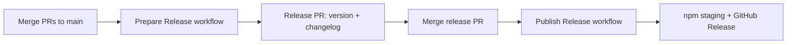

# Contributing

Thank you for contributing to `design-token-library`. This document covers local development, pull requests, changelog expectations, and how releases are published.

## Prerequisites

- **Node.js 22+** (matches CI and `package.json` `engines`)
- npm (bundled with Node)

## Local development

```bash
npm ci
npm run build    # compile TypeScript (project references)
npm test         # run tests (build first)
npm run test:coverage
npm run prettier # format src/
```

CI on `main` and pull requests runs `npm ci`, `npm run build`, and `npm run test:coverage`. Pushes to `main` also deploy the doc site to GitHub Pages.

## Pull requests

1. Branch from `main`.
2. Keep changes focused; match existing code style (Prettier).
3. Add or update tests under `src/test/` for behavior you change.
4. Update **CHANGELOG.md** under `## [Unreleased]` (see [Changelog strategy](#changelog-strategy)).
5. Open a PR against `main`. Ensure CI is green before merge.

Do not bump `package.json` `version` or cut release tags in feature PRs. Version bumps happen only through the [release process](#publishing-releases).

## Changelog strategy

This project follows [Keep a Changelog](https://keepachangelog.com/en/1.1.0/) and [Semantic Versioning](https://semver.org/spec/v2.0.0.html). Notable library changes belong in [CHANGELOG.md](./CHANGELOG.md).

### What needs a changelog entry

Add a changelog bullet for **any PR that changes shipped runtime behavior or exported typings**—that is, anything under `src/lib/` that affects the built package (`dist/lib/`), including:

- Runtime logic, errors, or output (even bug fixes and internal refactors that change behavior)
- Public or exported TypeScript types, declarations, or API surface (including type-only breaks or fixes)

If the runtime or exported types change, the PR should include a changelog entry. You do not need an entry for changes that touch only tests (`src/test/`), the doc site, CI/workflows, or repo docs, with no `src/lib/` changes.

### Where to write entries

- Add entries under the **`## [Unreleased]`** section at the top of the file (after the Keep a Changelog intro paragraphs).
- Do not add dated version headers or edit past release sections except to fix obvious typos.

### If `## [Unreleased]` is missing

Prepare Release moves `[Unreleased]` notes into a versioned section. Depending on release-it / keep-a-changelog behavior, **`## [Unreleased]` may not be present on `main` afterward** (for example right after a release with no pending notes, or when the section was empty).

Before you add changelog entries in your PR, restore the section yourself:

1. Open [CHANGELOG.md](./CHANGELOG.md).
2. Insert **`## [Unreleased]`** after the file introduction (the lines about Keep a Changelog and Semantic Versioning) and **before** the first `## [x.y.z]` release heading.
3. Add the usual category subsections (`### Added`, `### Changed`, etc.) only for categories you need.
4. Put your bullets under the right subsection.

Minimal example when nothing is unreleased yet:

```markdown
## [Unreleased]

### Added

- Short description of your change (#123).
```

Include restoring `[Unreleased]` in the same PR as your changelog bullets when the heading was missing on `main`.

### Categories

Use these subsection headings under `[Unreleased]` (omit empty sections):

| Heading   | Use for |
|-----------|---------|
| `Added`   | New features or public APIs |
| `Changed` | Changes to existing behavior |
| `Deprecated` | Features marked for removal |
| `Removed` | Removed features |
| `Fixed`   | Bug fixes |
| `Security` | Vulnerability fixes |

### Writing style

- One bullet per logical change; lead with what matters to library users.
- Reference issue or PR numbers when helpful (`#123`).
- **Breaking changes:** prefix the bullet with **`Breaking:`** (bold), and expect a **major** semver bump when the release is cut.
- API renames, DTCG shape changes, or type-level breaks that force consumer code changes are breaking unless clearly additive.

### What release automation does

The **Prepare Release** workflow uses [release-it](https://github.com/release-it/release-it) with [@release-it/keep-a-changelog](https://github.com/release-it/keep-a-changelog). When a maintainer runs it:

1. `[Unreleased]` content is moved into a new `## [x.y.z] - YYYY-MM-DD` section.
2. `package.json` `version` is updated to match.
3. A new empty `## [Unreleased]` section may be added; **if it is not**, the next contributor PR should recreate it (see [If `## [Unreleased]` is missing](#if-unreleased-is-missing)).

You should **not** manually rename `[Unreleased]` to a version number in normal PRs.

### Semver guidance for maintainers

When triggering **Prepare Release**, choose:

- **patch** — fixes and internal changes only
- **minor** — new backward-compatible features
- **major** — any `Breaking:` entries or other incompatible API changes

## Publishing releases

Publishing is automated; maintainers do not run `npm publish` locally for routine releases.

### Overview



### Step 1: Prepare Release

1. In GitHub Actions, run workflow **Prepare Release** ([`.github/workflows/prepare-release.yml`](./.github/workflows/prepare-release.yml)).
2. Choose **patch**, **minor**, or **major**.
3. The workflow creates a branch `release/v…`, runs release-it (changelog + version), pushes, and opens a PR to `main`.

Review the PR for correct version, changelog section, and `package.json` version only—no unrelated changes.

### Step 2: Merge the release PR

Merging the release PR triggers **Publish Release** ([`.github/workflows/publish-release.yml`](./.github/workflows/publish-release.yml)).

That workflow:

1. Checks out the merge commit on `main`.
2. Runs `npm ci` and `npm run build`.
3. Runs **`npm stage publish --access public`** using [npm trusted publishing](https://docs.npmjs.com/trusted-publishers) (OIDC from GitHub Actions—no long-lived `NPM_TOKEN` in the repo).
4. Creates a **GitHub Release** tagged `vX.Y.Z` with the body taken from the matching section in `CHANGELOG.md`.

### npm staging approval

Staged publishes sit in npm’s queue until a maintainer **approves** them in the npm UI. After approval, the version is live on the public registry.

### Manual publish workflow

**Publish Release** can also be started via **workflow_dispatch** for recovery; use only when you understand which commit and version should ship.

### What ships on npm

The published package includes compiled output under `dist/lib/` and `CHANGELOG.md` (see `files` in `package.json`).

## Questions

Open a [GitHub issue](https://github.com/nicholasrice/design-token-library/issues) for bugs or design discussions.
